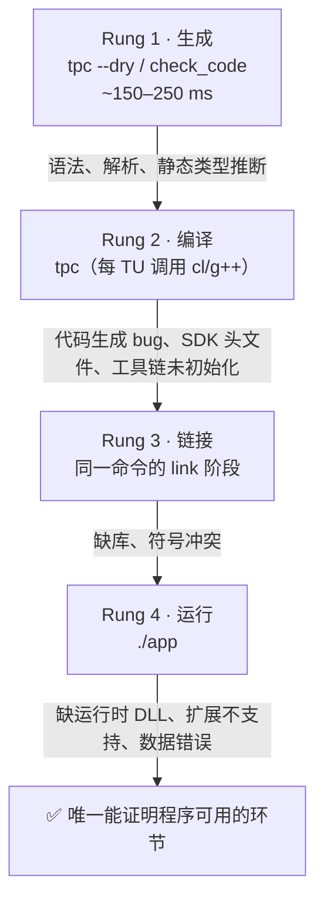

# typephp-project

> 面向 [TypePHP](https://github.com/swoole/typephp)（PHP → C++ AOT 编译器）的项目级技能：新建、改造、调试、审计，以及判断一份现有 PHP 代码到底能不能迁移到 AOT。

这个技能不是 API 手册，而是一套**判断纪律**。它解决的是 TypePHP 领域里最贵的一类错误：把"静态检查通过"当成"程序能跑"。

**目录**

- [为什么需要它](#为什么需要它)
- [核心模型：四级验证阶梯](#核心模型四级验证阶梯)
- [能力范围](#能力范围)
- [安装](#安装)
- [前置条件](#前置条件)
- [快速开始](#快速开始)
- [目录结构](#目录结构)
- [MCP 工具速查](#mcp-工具速查)
- [脚本](#脚本)
- [回归测试](#回归测试)
- [设计原则](#设计原则)
- [已知边界](#已知边界)
- [许可](#许可)

---

## 为什么需要它

TypePHP 把 PHP 编译成原生二进制。这一句话解释了几乎所有失败模式：源码是 PHP，**验收标准是 C++ 编译器的**，运行时是链接进来的 PHP runtime 而不是解释器。三者错位，于是出现了一类在其他 PHP 项目里不存在的失败——能过检查、能编译、能链接，一运行就崩。

`check_code` 走的是 `tpc --dry`，它**只生成 C++**，不编译、不链接、不执行。在 tpc v0.9.5 / Windows x64 / MSVC 14.44 上的实测：

| 输入 | `check_code` | 真实构建 | 运行 |
|---|---|---|---|
| `echoo("done")`（拼错函数名） | OK, `diagnostics=0` | 成功 | `call to undefined function` |
| `new Calc()`（全项目无此类） | OK, `diagnostics=0` | 成功 | `class 'Calc' is undefined` |
| 缺少 `]`（真语法错误） | FAILED，带 `file:line` | — | — |
| `$count = 1; $count = "one";` | FAILED，类型不匹配 | — | — |

原因是未定义符号在**运行时**通过 PHP 的类/函数表动态解析，编译器没有理由报错。所以：**绿灯是必要条件，永远不是充分条件。**

同类陷阱还有两处，都是实测出来的：

- 用 `check_code` 审计 `vendor/psr/log/src` 的 8 个文件 → **8/8 FAIL**；同样 8 个文件用 `tpc --dry --mode=lib` 整目录编译 → **0 FAIL**。前者是 bin 模式要求 `main()` 造成的模式错配，不是兼容性结论。照前者汇报，等于用看起来很权威的证据给出完全错误的答案。
- 默认优化级别是 `-O0`。`fib(30)` 实测 19.1 ms（默认）对 5.8 ms（`-O2`），3.3 倍差距来自一个没人传的参数。用默认构建做性能结论必然是错的。

---

## 核心模型：四级验证阶梯



每一级捕获不同的缺陷类别，也各有盲区：

| 级别 | 命令 | 能捕获 | 看不到 |
|---|---|---|---|
| 1 生成 | `tpc --dry` / `check_code` | 语法、解析、静态类型推断、禁用构造 | 下游全部 |
| 2 编译 | `tpc`（逐 TU 调 `cl`/`g++`） | C++ 代码生成问题、SDK 头文件缺失、**工具链未初始化** | 链接错误、运行时 |
| 3 链接 | 同一命令的 link 阶段 | 缺库、符号冲突 | 运行时能力 |
| 4 运行 | `./app` | **缺运行时 DLL**、扩展不支持、数据错误 | — |

**规则：`check_code` 绿灯只代表"编译器接受了语法和类型"；项目在 Rung 4 真正执行过一次之前，不算验证完成。** 汇报时必须点名到达了哪一级——"能编译" / "能链接" / "能跑"是三个不同结论。

---

## 能力范围

| 你要做的事 | 技能给出的东西 | 对应文档 |
|---|---|---|
| 从零建项目 | 目录输入 vs 文件输入的选择、`project.yml` 全字段、推荐布局 | `references/project-layout.md` |
| 写能编译的 PHP | 与原生 PHP 差异最大的惯用法、通用方法形式 | `references/typephp-idioms.md` |
| 判断某特性还能不能用 | Hard Limit / Intentional Rule / Pending / Partial 四分类 | `references/incompatibility-taxonomy.md` |
| 去掉样板代码 | `#[Getter]` `#[Setter]` `#[Constructor]` `#[With]` `#[Immutable]` `#[MethodsFor]` 等编译期属性 | `references/attributes-reference.md` |
| 声明容器与原生类型 | `#[StdVector]` `#[StdDict]` `#[Native]` 类型注解契约 | `references/type-annotations.md` |
| 搞清静态类型何时退化为 `php::Var` | 类型系统的锐边与性能影响 | `references/type-system.md` |
| 构建/运行失败 | 错误串 → 真实原因的映射，区分代码故障与环境故障 | `references/debugging.md` |
| 崩溃、内存错误 | GDB/LLDB 符号方案、`--sanitize=address` | `references/debugging-native.md` |
| 审计第三方 / vendor 代码 | 目录扫描、`--mode=lib`、假阳性识别、按修复成本分类 | `references/auditing-code.md` |
| 构建 PHP 扩展（`mode: ext`） | 宿主 PHP 实际加载并返回正确值才算通过 | `references/ext-mode.md` |
| 在 CI 里加子集检查 | `exit=1` 是配置错误，只有 `255` 才是真失败 | `references/ci-gating.md` |
| 按规格生成代码 | LLM 自信引入、恰好能骗过 `check_code` 的那类缺陷 | `references/code-generation.md` |
| 让编译产物真的快 | `-O0` 默认值、热循环里的 boxed `php::Var` | `references/performance.md` |
| 规则与编译器版本对齐 | 版本戳、升级前后 `get_changelog` 的用法 | `references/knowledge-sync.md` |

### 两个最容易踩的坑

**编译期属性真实存在，但住在根命名空间。** 在 `namespace App;` 里必须写 `#[\Getter]` 或先 `use \Getter;`，否则属性被**静默忽略，不报任何错**。方法生成属性（`#[Getter]`…）会展开成真实方法；类型注解（`#[StdVector(Type::Int)]`…）被类型检查器消费、改变参数**接受什么**。两族语法相同、职责不同，混淆会得到"看起来有注解、实际没有"的代码。

**类型系统有一批能编译通过、语义却变了的行为。** `unset()` 作用于 `std::vector` 元素是重置为零值而非删除；读取 `std::map` 缺失键抛异常而非返回 null；`$array[null] = 1` 是追加而不是使用 `''` 键；未初始化的类型化属性读出 `0` 而不是报错。这些都属于语义层，`check_code` 永远看不见。

---

## 安装

技能就是 `skills/typephp-project/` 这个目录，安装即把它放到技能搜索路径下。

### 用 npx 安装（推荐）

不需要 npm 账号，也不需要预先 clone，直接从 GitHub 拉取执行：

```bash
npx github:yangweijie/typephp-skills install            # ~/.workbuddy-ai/skills，用户级
npx github:yangweijie/typephp-skills install --claude   # ~/.claude/skills，用户级
npx github:yangweijie/typephp-skills install --project  # ./.workbuddy-ai/skills，项目级
npx github:yangweijie/typephp-skills install --dir ./skills   # 自定义目录
```

目标已存在时默认跳过；加 `--force` 覆盖，旧目录会先备份为 `<name>.bak-<时间戳>`，不会直接删除。安装完重启客户端才生效。

### 手动安装

| 客户端 | 用户级 | 项目级 |
|---|---|---|
| WorkBuddy | `~/.workbuddy-ai/skills/` | `.workbuddy-ai/skills/` |
| Claude Code | `~/.claude/skills/` | `.claude/skills/` |

```bash
git clone git@github.com:yangweijie/typephp-skills.git
cp -R typephp-skills/skills/typephp-project ~/.workbuddy-ai/skills/
```

其他兼容 Agent Skills 的客户端同理——`SKILL.md` 的 frontmatter 格式通用，拷目录即可。

**一个必须满足的约束**：`SKILL.md` 要在技能根目录直接可见。加载器不会递归寻找嵌套的 `SKILL.md`，所以别把目录再套一层。

## 前置条件

技能本身只依赖文件系统，但要让里面的命令真正跑起来，还需要：

| 依赖 | 用途 | 缺失时的表现 |
|---|---|---|
| `tpc`（TypePHP 工具链，`PHP_HOME` 下或 PATH 中） | 全部构建与 `check_code` | 什么都编译不了 |
| C++ 工具链（MSVC / g++ / clang++） | Rung 2 编译 | `C/C++ compiler executable not found` |
| typephp-mcp 服务 | 12 个 MCP 工具、结构化诊断 | 降级为直接调 `tpc --dry` |
| PHP 解释器（可选） | 跑 `evals/` 回归、纯 PHP 单元测试 | 只影响验证，不影响构建 |

**typephp-mcp 不在 `v0.9.5` 发布标签里。** 它随 PR #174 合并进 master（`tools/typephp-mcp`），所以用 tag 检出的代码树里根本找不到这个目录——报 `no such directory` 是版本问题，不是路径写错。按 master 构建出来的服务自报 `tpc_version: v0.9.6`。装之前先确认一件事：

```bash
git ls-tree -r --name-only origin/master -- tools/typephp-mcp | head -3
```

Windows/MSVC 有一个隐蔽前提：**`cl.exe` 在 PATH 上还不够，`INCLUDE` 必须指向 MSVC 头文件目录**。否则 `tpc` 报 `fatal error C1083: cannot open include file "malloc.h"`——这不是缺库，也不是代码问题，而是 `vcvars64.bat` 没被 source 过。先修 shell，别改 PHP。

跑一下体检脚本，一次问清"这台机器能不能构建"：

```bash
bash scripts/preflight.sh /path/to/your-project     # Windows: scripts\preflight.bat
```

### 构建 typephp-mcp（macOS）

Unix 侧没有 Windows 那种自带 phpx/PHP SDK 的 tpc 发行包，所以 `build.sh` 要求一个 embed 运行时。实测可用的最小步骤：

```bash
cd /path/to/typephp-compiler            # master 分支，tpc 版本 ≥ v0.9.6

# 1. phpx 必须够新：编译器会生成 php::empty_string，旧 phpx 能编完、只在链接期死
composer update swoole/phpx             # 需要 ~2.9.5 及以上

# 2. composer 包里只有 include/phpx.h，没有 libphpx —— 自己编一个
cmake -S vendor/swoole/phpx -B /tmp/phpx-build \
      -DCMAKE_BUILD_TYPE=Release \
      -DPHP_CONFIG=$PHP_HOME/bin/php-config
cmake --build /tmp/phpx-build --target phpx -j4

# 3. 编译 MCP 本体（PHP_HOME 指向 lib/libphp.a 所在前缀）
PHP_HOME=$HOME/.typephp/php-builder/php-8.5.11-*/install \
  bash tools/typephp-mcp/build.sh
```

第 2 步的产物会落到 `vendor/swoole/phpx/lib/libphpx.dylib`，正好是 `build.sh` 的第三个候选目录，所以不用显式设 `PHPX_HOME`。注意 `-DPHP_CONFIG` 不能省：CMakeLists 在 Unix 上只认 `php-config`，漏了它会静默退回 Homebrew 的 PHP（那个前缀没有 embed 库），链接阶段才炸。

接入 MCP 客户端（`~/.workbuddy-ai/mcp.json`）：

```json
{
  "mcpServers": {
    "typephp-mcp": {
      "command": "/path/to/typephp-compiler/tools/typephp-mcp/typephp_mcp",
      "args": [],
      "env": {
        "TYPEPHP_MCP_ROOT": "/path/to/typephp-compiler",
        "TYPEPHP_MCP_PHP": "/opt/homebrew/bin/php",
        "PHP_HOME": "/Users/you/.typephp/php-builder/php-8.5.11-<hash>/install",
        "PHPX_HOME": "/path/to/typephp-compiler/vendor/swoole/phpx"
      }
    }
  }
}
```

`TYPEPHP_MCP_PHP` 建议写绝对路径：客户端（尤其 GUI 启动的）PATH 往往是 `/usr/bin:/bin:/usr/sbin:/sbin`，`check_code` 走解释执行的 `php bin/tpc.php` 时会找不到 `php`。改完配置需要重启客户端才生效。


## 快速开始

技能由对话意图触发，不需要记命令。典型的开场白：

```
用 TypePHP 起一个命令行小工具：读 CSV，按列分组求和，按数值降序打印。
最后要能编译成 exe 跑起来。
```

```
这段 TypePHP 代码 check_code 一直是 OK，但编译出来的程序一跑就报
class 'OrderRepo' is undefined，帮我修好并确认能跑。
```

```
评估一下 vendor/psr/log 能不能迁到 TypePHP，给我一份失败清单。
```

技能内部会走这条流程：

1. **先确认环境**（`preflight`），因为两个环境故障会长得像代码 bug。
2. **写代码前加载红线规则**（`list_restrictions`）——编译到第一个错误就停，每条没读过的规则都要付一整轮的代价。
3. **确定项目形态**（`get_build_config_help` + `project-layout`）。
4. **写代码，逐文件 `check_code` 迭代到绿**（约 150–250 ms/次），不要每次编辑都构建，累积后统一构建。
5. **真构建 + 真运行**，并如实汇报到达了哪一级。
6. **收尾清单**：每个改过的文件 `check_code` 绿、跑过真实构建、二进制至少执行一次、知道运行时依赖（`dumpbin /DEPENDENTS` 或 `ldd`）、没有把产物写进工具链安装目录。

一个反复被强调的提醒：**大多数普通 PHP 是能用的，不要预防性回避。** `usort` 配闭包、`array_map`、`match`、`array_column`、`json_decode`、按引用 `foreach` 都实测可用。限制清单很短且具体；想写的东西不在清单上，就按正常方式写，让编译器来反对。为了"以防万一"手写插入排序和 CSV 解析器，只会增加行数，并引入恰好会在运行期晚失败的动态调用路径。

---

## 目录结构

```
typephp-project/
├── SKILL.md                      # 技能主体：验证阶梯、工作流、收尾清单
├── README.md
├── references/                   # 17 篇按需加载的深文档
│   ├── verification-ladder.md        # 每级阶梯证明什么、掩盖什么（含实测数据）
│   ├── project-layout.md             # 目录 vs 文件输入、project.yml、产物落地
│   ├── typephp-idioms.md             # 与原生 PHP 差异最大的惯用法
│   ├── type-system.md                # 静态类型何时退化为 php::Var
│   ├── attributes-reference.md       # 编译期属性完整参考
│   ├── type-annotations.md           # 类型注解完整参考
│   ├── compile-time-attributes.md    # 样板代码消除（入门向）
│   ├── incompatibility-taxonomy.md   # 不兼容性的四种性质
│   ├── debugging.md                  # 构建/运行失败的错误串映射
│   ├── debugging-native.md           # 崩溃与内存错误的 GDB/ASAN 路径
│   ├── auditing-code.md              # 第三方代码审计与迁移评估
│   ├── ext-mode.md                   # mode: ext
│   ├── ci-gating.md                  # CI 子集门禁
│   ├── code-generation.md            # 按规格生成
│   ├── performance.md                # 编译产物性能
│   ├── knowledge-sync.md             # 规则与编译器版本对齐
│   └── mcp-tools.md                  # 12 个 MCP 工具的选择策略
├── scripts/
│   ├── preflight.sh / .bat           # 环境体检：工具链、tpc、PHP_HOME、project.yml
│   └── audit-dir.sh / .bat           # 批量兼容性扫描（默认 lib 模式、整目录）
├── evals/
│   ├── evals.json                    # 3 个端到端场景（新建 / 绿灯崩溃 / 迁移改造）
│   └── attribute-regression/         # 30 个属性与类型注解回归用例 + run.php
└── *.stub.php                        # import-library 桩文件样例（空实现签名声明）
```

`references/` 是**按需加载**的：SKILL.md 只保留决策所需的最小上下文，深文档在对应场景才读。这样技能在上下文里占的空间可控，又不牺牲深度。

---

## MCP 工具速查

typephp-mcp 通过 stdio 本地运行，不外发数据。12 个工具里，真正能省轮次的是前四个：

| 工具 | 什么时候调 | 输出 |
|---|---|---|
| `list_restrictions` | **写任何 TypePHP 之前** | 红线规则，约 1.6 KB。主题：`structure` `types` `refs` `objects` `control` `runtime` `std` `stub` `build` |
| `get_build_config_help` | 写/改 `project.yml`、加源文件、选模式之前 | 三种模式的字段参考、CLI 参数、stub 契约 |
| `search_docs` | 概念性问题（"类型化 map 怎么声明"） | 文档片段 + `docs/<lang>/<file>.md#heading (L<line>)` 引用 |
| `check_code` | 每次有效编辑之后 | `OK/FAILED stage=generate ... diagnostics=N` 及 `file:line` |

其余：`search_code`（找可用范式）、`get_symbol`（确认签名存在）、`get_example`（整份可运行示例）、`list_stdlib`（下结论"不支持"之前先查）、`get_stub_api`、`get_changelog`、`list_topics`、`get_index_info`（版本漂移检测）。

两个使用约束值得记住：

- `check_code` **只接受单个 `.php` 文件**（绝对路径，或相对 MCP 仓库根）。目录和 `project.yml` 会被拒绝，这是安全设计——解析项目配置可能触发一次真实构建。不要绕过它。
- `check_code` **固定跑 bin 模式**，这是硬限制。库文件没有 `main()`，会被统一拒绝并返回 `The Embed SAPI requires a global main() function`。**那是模式错配，不是兼容性结论。**

环境变量：`TYPEPHP_MCP_ROOT` 指向工具资源（编译器 checkout），不是用户项目；`TYPEPHP_MCP_TPC` 指定 `check_code` 用哪个 `tpc`（建议钉在 release 包上，仓库根构建的 `tpc.exe` 曾出现 `0xC0000139`）；`TYPEPHP_MCP_PROJECT_ROOT` 在没有 MCP roots 时补上用户项目搜索路径。

## 脚本

**`scripts/preflight.sh` / `.bat`** —— 构建前体检。检查平台、C++ 工具链（Windows 上单独验 `INCLUDE`）、`tpc` 可达性、`PHP_HOME`/`PHPX_HOME`、`project.yml` 是否存在及模式与源文件数。退出码 0 = 就绪，非 0 = 列出的问题会让每次构建都失败。

**`scripts/audit-dir.sh` / `.bat`** —— 审计不是你写的 PHP 代码。

```bash
bash scripts/audit-dir.sh vendor/psr/log/src            # 默认 lib 模式，整目录
bash scripts/audit-dir.sh my-app/                       # 含 project.yml → 按清单整应用编译
bash scripts/audit-dir.sh src/ --mode bin --max-exclusions 5
```

它存在的理由有三个：`check_code` 只能跑 bin 模式（库代码全被判失败）；逐文件扫描会因为跨文件继承和 trait 无法解析而误报（`psr/log` 实测逐文件 2/8 失败、整目录 0/8 失败，约 25% 假阳性）；`tpc` 遇到第一个 fatal 就停，一次扫描只报一个问题。`--max-exclusions` 会迭代排除问题文件以枚举更多，但结果标记为 `CONTAMINATED`——排除文件会引发级联失败。

注意 `--mode` 只接受等号形式：`--mode=lib` 正确，`--mode lib` 会被当成输入路径并报 `path not exists: lib`。

## 回归测试

`evals/attribute-regression/` 是这份技能里所有"属性可用"断言的证据集。每个用例在文件第 2 行声明期望：

```php
// expect: FAIL | <编译器输出中必须出现的子串>
// expect: PASS
// expect: PASS_WARN | <子串>
// expect: RUN | <对 stdout 的正则>
```

```bash
php evals/attribute-regression/run.php evals/attribute-regression/cases
php evals/attribute-regression/run.php evals/attribute-regression/cases --build
```

默认只跑 25 个 `--dry` 用例（秒级）；`--build` 追加 5 个 `RUN` 用例，会真实编译链接并执行（每个约 1–2 分钟）。**升级 tpc 之后跑一遍**——技能里的规则都带版本前提，编译器一动，旧结论就可能变成谣言。

`evals/evals.json` 则是三个端到端场景（从零建 CLI 项目、绿灯但运行崩溃、把普通 PHP 迁移过来），用来检验技能整体的行为，而不只是单条规则。

---

## 设计原则

这份技能刻意做了几个取舍，改动它之前值得知道：

**只写实测结论，不写推测。** 每个数字（264 ms 单文件检查、19.1 对 5.8 ms、8/8 对 0/8）都标注了测量环境。编译器还很年轻，凭记忆写的规则会安静地腐烂。

**"不支持"必须带分类。** 只说"不支持"，读者无法判断该重构还是该等待。Hard Limit 当成 Pending 会丢掉一个季度，Pending 当成 Hard Limit 会做无谓的重新设计。

**不预置回避。** 技能的默认姿态是"按正常 PHP 写，让编译器反对"，而不是提前假设一切都不可用。过度防御性代码引入的动态调用路径，恰恰是最容易在运行期晚失败的那种。

**把工具的能力边界写进工具说明。** `check_code` 很好用，也很容易误用。明确它看不见什么，比列举它能做什么更有价值。

## 已知边界

- 全部实测数据基于 **tpc v0.9.5 / Windows x64 / MSVC 14.44**。其他版本请以 `get_index_info` 的 `staleness` 和 `get_changelog` 为准，必要时重跑 `evals/`。
- 技能描述的行为面（12 个工具、`check_code` 只跑 generate 阶段）在 master 构建的 MCP 上复核过；该构建自报 `tpc_version: v0.9.6`，与上一条的 v0.9.5 测量基线不是同一个版本，两者不要混用。
- 脚本同时提供 `.sh` 与 `.bat`，但构建链路的实测以 Windows/MSVC 为主；Linux/macOS 的 `g++`/`clang++` 路径可用，覆盖度不如 Windows。
- 部分行为属于文档未承诺的实践观察（例如 bin 构建里 `__DIR__` 实际按可执行文件目录解析），技能里已明确标注"不要基于它设计数据路径策略"。
- `*.stub.php` 是 import-library 桩文件样例，用于说明空实现签名声明的格式，不参与构建。

## 发布（维护者）

包名 `typephp-skills`，`bin/cli.js` 提供安装器，`files` 只打包 `bin/`、`skills/`、`LICENSE`。

**当前状态：主分发走 GitHub 直装（`npx github:yangweijie/typephp-skills install`），npm 包已就绪但尚未发布。** 下面的流程在 npm 账号认证解决后启用。

**推荐：打 tag 由 GitHub Actions 发布（OIDC 可信发布，不需要 token，也不需要 OTP）**

```bash
npm version patch          # 或 minor / major，会顺带打 tag
git push --follow-tags
```

`.github/workflows/publish.yml` 用 `id-token: write` 走 OIDC，npm CLI 自动检测并优先使用它。前置是在 npmjs.com 的包设置里填 Trusted Publisher：`yangweijie` / `typephp-skills` / `publish.yml`，**配置后必须在 2 天内完成首次发布**，否则配置过期需重建。`package.json` 的 `repository.url` 必须与仓库地址精确匹配，否则发布会失败。

**本地发布（需要 token）**

```bash
npm pack --dry-run                    # 先看包内容
npm publish --registry=https://registry.npmjs.org/
```

注意本机 `~/.npmrc` 的默认 registry 是镜像源，**发布必须显式指定官方源**，否则会 404 或 401。token 用 Granular Access Token 并勾选 Bypass 2FA，`npm login` 的交互式 OTP 走不通时这是唯一可靠路径。

## 许可

[MIT](../../LICENSE) © 2026 yangweijie
